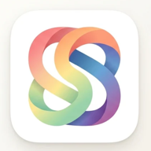

<p align="center">
  
</p>

<h1 align="center">satio-plugins</h1>

<p align="center">官方插件 / 世界目录 —— 客户端「市场」页加一条地址就能读到它。</p>

<p align="center">
  <a href="https://satio-verse.gitgraduate.com">官网与在线目录</a> ·
  <a href="https://github.com/satio-verse/satio-verse">主仓库</a>
</p>

这是 [S.A.T.I.O Verse](https://github.com/satio-verse/satio-verse) 的**插件与世界的官方目录仓库**。
客户端「市场」页读的就是这里的 `index.json`；线上还有一份可直接加的地址：<https://satio-verse.gitgraduate.com/index.json>。

## 目录结构

```
index.json                 # 市场索引（客户端读这个）
packages/<id>/wmworld.json # 插件包（世界插件必须有 world 块）
packages/<id>/README.md    # 给用户看的说明
.github/workflows/validate.yml
tools/validate_packages.py # 本地等同于 CI 的校验脚本
```

## 提交一个插件

1. Fork 本仓库，新建 `packages/<你的插件 id>/`，放入 `wmworld.json`、说明文档、以及界面/资源文件
2. 本地校验：
   ```bash
   git clone https://github.com/satio-verse/satio-verse ../satio-verse
   python tools/validate_packages.py --verse ../satio-verse
   ```
3. 提 PR。CI 会跑同一套契约校验（`wmworld.json` schema 2 + 动作/事件命名 + 文件齐备 + 权限声明）

## 契约要点（世界插件）

```json
{
  "id": "myworld",
  "name": "我的世界",
  "plugin": {
    "schema": 2,
    "version": "0.1.0",
    "tier": "panel",
    "permissions": {"local": ["127.0.0.1:8801"], "notify": false},
    "panel": {"entry": "spectate.html", "tools": ["myworld_look"]},
    "world": {
      "kind": "space",
      "prefix": "myworld",
      "events": ["myworld_move", "myworld_say", "myworld_entered", "myworld_left", "myworld_act"],
      "actions": ["myworld_walk", "myworld_sit", "myworld_say", "myworld_look"],
      "perception": {"visible": 6, "hidden": 3},
      "leave": {"ack_timeout_s": 3}
    }
  }
}
```

- `kind`：`chat` / `space` / `game`
- 动作名必须是 `<prefix>_<动词>`，小写字母、数字、下划线
- 权限分四档：`text` / `panel` / `code` / `process`，宿主默认只给 `text`
- 装前报告不过关的包客户端会直接拒装；**不要试图绕过**

## 许可

包内容的许可由各自作者在 `wmworld.json` 的 `license` 字段声明；本仓库自身的索引与工具用 Apache-2.0。
